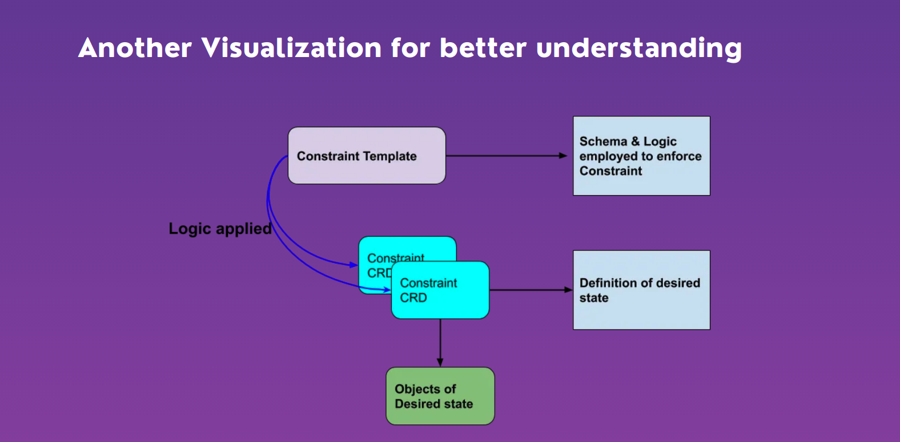

## Why Policy as Code

It is better to enforce best practices, code standards or company policies that go beyond common security checks.

## Open Policy Agent (OPA)

OPA is a General-Purpose Policy Engine 

- OPA is an open-source project that provides a general-purpose policy engine for cloud-native environments
- Policies are expressed in a high-level, declarative langueage called Rego
- It lets you define audit policies for: Kubernetes, APIs, Container, Service Mesh and more.
- It can be integrated with CI/CD pipelines.

## OPA Gatekeeper

Gatekeeper is the bridge between API server and OPA.

- Gatekeeper is a project that enforces OPA policies in Kubernetes - built in for Kubernetes specifically.
- It uses OPA as a policy engine

- It is an **admission controller** which is a plugin that intercept requests to the API server before they are persisted to the cluster's etcd data store.

1. API server is the entrypoint to the cluster and handles all requests.
2. Whenever a resource is created, updated or deleted, the API server triggers the Gatekeeper admission webhook to process the admission request.
3. OPA decides and sends back the response, API server enforces based on admission response

1. K8s admin defines the Policy (e.g. NodePort Service type is not allowed)
2. Developer pushes Service Manifest with NodePOrt type
3. API server sends the request to Gatekeeper which checks with OPA.
4. If policy is violated, request is denied.

### Gatekeeper Components:

- Controller Manager (the validation admission controller)
- Audit functionality

### CRDs

- ConstraintTemplate and Constraint define the policies.

Each policy has its own contraint template. You can have multiple constraints based on it.

**Constraint** thr definiotion of desired state for specific object. It's used to inform Gatekeeper that admin wants a Contrant Template to be enforced for that object.

---

### Example OPA Gatekeeper Policy Library

- Block NodePort: disallows all NodePort services
- Require Labels: ensures certain labels are present on resources
- No Privilege Containers: blocks containers running as root
- Limit Resource Requests: ensures pods have resource limits set
- HTTPS Only: ensures services use HTTPS