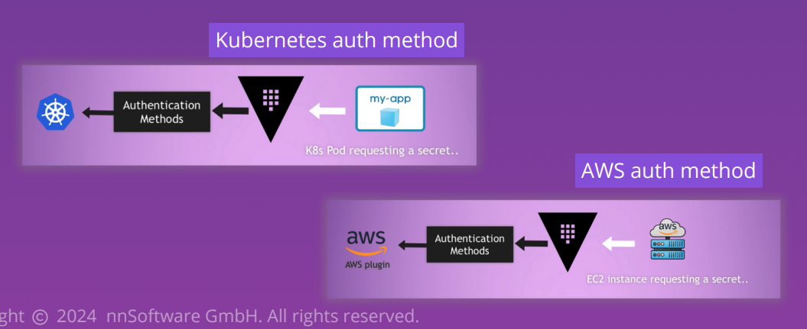

## Key Functionalities of Secret Management Tools

**Purpose:**

- Offer centralized platform to manage all secrets
- Secure storage solution

**Encryption at Rest**

- Data is encrypted when stored on the disk

**Encryption in transit:**

- Data is encrypted when transmitted over the network

### Other Key Functionalities

- Fine grained access control
- Audit and Compliance

# HashiCorp Vault

**Dynamic Secrets:** 

- Vault can generate secrets on-demand with a limited lifetime (e.g. dynamically generated database credentials)
- Every client gets its own unique credentials
  - In case of a leak, enales us to pintpoint compromised client
  - Credential rotation is easier
  - Prevent outage for all other un-compromised clients

**Encryption As a Service:**

- Vault can encrypt and decrypt data - when hacker gets hold of th data they can not read it.

## Vault Architecture

- Vault has a client-server architecture
- Clients interact with Vault via API calls

**Vault Core:**

- Central component that processes all requests

**Authentication method:**

- Auth methods perform authentication and are responsible for assigning identity and a set of policies to a user
- Vault delegates the authentication to the relevant configured external auth method
- It validates client's identity against those trusted third-party sources

Examples:

- AWS for IAM principals and EC2 instances
- K8s for K8s Pods
- LDAP for human users

**Authentication & Authorization Flow**§

1. Vault authenticates clients with configured authentication methods
2. As a response, client token with a set of policies is issued
3. This client token is used to make future requests and verify the client, ensuring they are authorized
4. The policies are used to authorize the client request
5. The request is then routed to the secrets engine, which is processed depending on its type

**Secrets Engine:**

- Handles storage and retrieval of secrets
- Can be dynamic or static depending on the type
    - Some simply store and read data - like encrypted Redis/Memcached
    - Others connect to other services and generate dynamic credentials on demands

---

## Secrets Management in Kubernetes

In K8s secrets are base 64 encoded which is not really secure and can be easily decoded if accessed by unauthorized users.

- We can use ExternalSecrets and Secret Store to manage secrets more securely in K8s. For more info -> [ClusterSecretStore and ExternelSecret](https://gitlab.com/dominikjaro_devsecops_bootcamp/online-boutique-gitops)