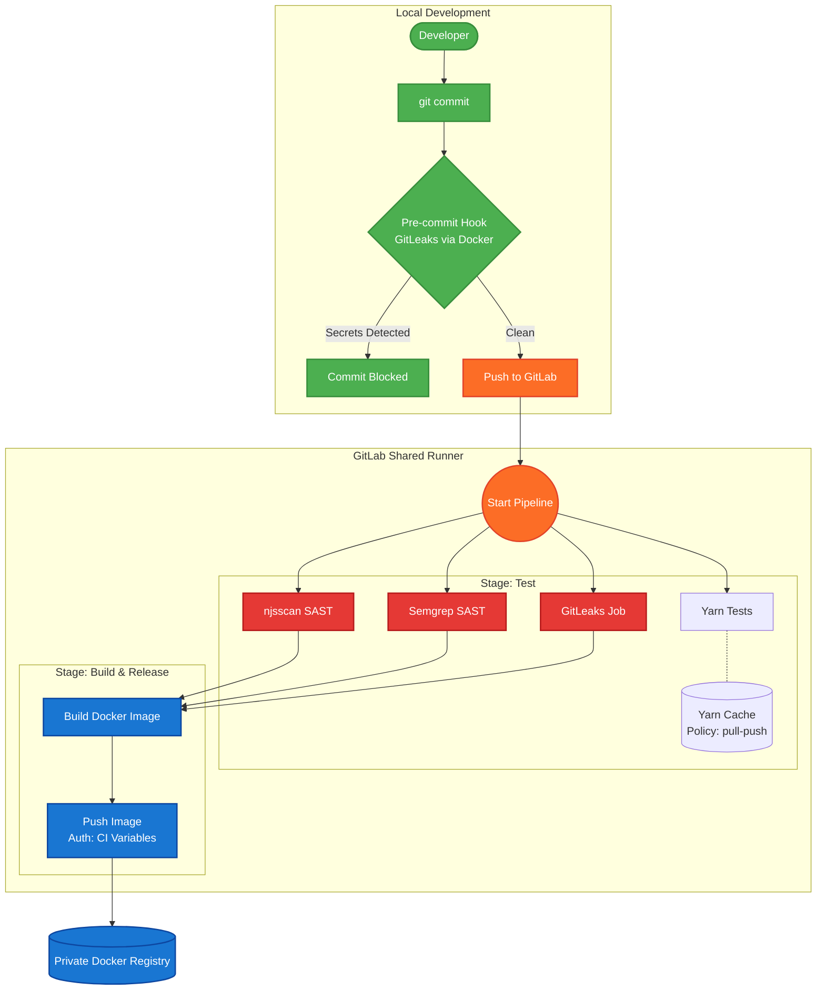

- [Module 3: Application Vulnarability Scanning](#module-3-application-vulnarability-scanning)
  - [Setup GiLab CI pipeline, pre-commit script and SAST scanning](#setup-gilab-ci-pipeline-pre-commit-script-and-sast-scanning)
- [Module 4: Vulnerability Management and Remediation](#module-4-vulnerability-management-and-remediation)
- [Module 19: Service Mesh with Istio](#module-19-service-mesh-with-istio)
  - [Part1: Deployed Istio Service Mesh components in EKS Cluster via our Terraform pipeline](#part1-deployed-istio-service-mesh-components-in-eks-cluster-via-our-terraform-pipeline)
  - [Part2: Expose microervice app through Istio gateway via secure HTTPS access](#part2-expose-microervice-app-through-istio-gateway-via-secure-https-access)
  - [Part3: Validated Istio mTLS traffic and configured PeerAuthentication](#part3-validated-istio-mtls-traffic-and-configured-peerauthentication)
  - [Part4: Define Authorization Policies on workloads](#part4-define-authorization-policies-on-workloads)
- [Module 20: Compliance as Code](#module-20-compliance-as-code)

# Module 3: Application Vulnarability Scanning

## Setup GiLab CI pipeline, pre-commit script and SAST scanning

**repo: app_juice_shop**

- We use the OWASP open-source app Juice Shop
- Created a basic GitLab CI pipeline for the app which runs on a GitLab shared runner
  - We run Yarn tests, build the image and push to our private docker registry
  (authentication to registry via GitLab CI variables)
  - To make the pipeline faster we configure caching for Yarn dependencies
    - We set the poicy to pull-push for caching -- so it updates when needed
  - `GitLeak` is the next job in the pipeline which scans for secrets in the repo
    - We set `allow_failure` to true for now so it doesn't block the pipeline
    - Save the output `gitleaks.json` as an artifact (will use it latet yo upload it to Defect Dojo) for review
    - To prevent commiting credentials to the repo we set up a Pre-commit hook
      - In the `.git/hook` dir we create a `pre-commit` file with the script to run `gitleaks` (we are using a docker image and passing the app code)
  - `njsscan`is added and configured in the pipeline to SAST checks
    - We add the flag `--exit-warning` to fail on warnings
  - `semgrep` is added and configured in the pipeline for additional SAST checks
    - Again the output is saved as an artifact for review.



---

# Module 4: Vulnerability Management and Remediation


---

# Module 19: Service Mesh with Istio

## Part1: Deployed Istio Service Mesh components in EKS Cluster via our Terraform pipeline

**repo: Infra**

- I installed `istiod`, `istio-base` and `istio-ingress-gateway` components in the cluster.
- I added cluster and node level security groups and rules for secure communication.
- By adding a label I enable Istio envoy proxy injection (at first for one namespace only).
  - It means only the objects in that namespace will get the proxy injected.
- The IaC pipeline will create the necessary resources.

## Part2: Expose microervice app through Istio gateway via secure HTTPS access

**repo: GitOps**

- Configured traffic routing in cluster via Istio gateway.
  - At first we test with HTTP(80) before enabling HTTPS.
  - Generated a self-signed certificate useing `openssl` for TLS communication and store it in AWS Secret Manager.
  `openssl req -x509 -sha256 -nodes -days 365 -newkey rsa:4096 -subj '/CN=onlineboutique.dom.com' -keyout key.pem -out cert.pem`
  - We enabled HTTPS(443) and redirect all HTTP traffic to it.
  - For the TLS certificate and key we use AWS Secret Manager and K8s external secrets.
- Created a Virtual Service for the frontend application to route traffic through the gateway to the service.

## Part3: Validated Istio mTLS traffic and configured PeerAuthentication

**repo: GitOps**

- Downloaded tool `istioctl`
- Configured PeerAuthentication
  - Set mode to STRICT for mTLS in the namespace `online-boutique`
  (That means pods can't communicate in Plaintext)

## Part4: Define Authorization Policies on workloads

**repo: GitOps**

- Created an `AuthorizationPolicy` (`frontend-policy`) targeting `app: frontend` in the `online-boutique` namespace.
  - Configured a `DENY` rule blocking requests from other pods inside `online-boutique` on port `80, 8080` while permitting external traffic routed from `istio-ingress`.
- Created a namespace-level policy deployed in `online-boutique` to DENY all incoming traffic originating from the `argocd` namespace.
- To test the communication we also used a test pod in the cluster:
  - `kubectl run -it --image curlimages/curl -n online-boutique --restart=Never mypod -- sh`

```mermaid
flowchart TD
    User([User Request HTTPS 443]) --> NLB

    subgraph AWS VPC
        NLB[AWS Network Load Balancer\nIngress: 80/443\nEgress: All]
        
        subgraph EKS Cluster Nodes
            NLB -- "NodePort (30000-32767)" --> IGW
            
            subgraph istio-system [namespace: istio-system]
                Istiod[Istiod Control Plane\nWebhook Port: 15017]
                IGW[Istio Ingress Gateway\nEnvoy Proxy]
            end
            
            subgraph online-boutique [namespace: online-boutique]
                VS[VirtualService\nRouting Rules]
                
                subgraph Pods
                    FE[Frontend Pod]
                    Sidecar[Envoy Sidecar]
                    FE -.- Sidecar
                end
            end
            
            subgraph argocd [namespace: argocd]
                Argo[ArgoCD Pods]
                ArgoSidecar[Envoy Sidecar]
                Argo -.- ArgoSidecar
            end
        end
    end

    IGW -- "VirtualService routes traffic" --> VS
    VS -- "STRICT mTLS (PeerAuthentication)" --> Sidecar
    Istiod -. "Injects Sidecars & Certs" .-> Sidecar
    Istiod -. "Injects Sidecars & Certs" .-> ArgoSidecar
    Istiod -. "Injects Sidecars & Certs" .-> IGW
    
    ArgoSidecar -- "Blocked by AuthorizationPolicy" --x Sidecar

    classDef aws fill:#FF9900,stroke:#232F3E,stroke-width:2px,color:white;
    classDef istio fill:#466BB0,stroke:#2b426d,stroke-width:2px,color:white;
    classDef k8s fill:#326ce5,stroke:#1f438f,stroke-width:2px,color:white;
    
    class NLB aws;
    class Istiod,IGW,Sidecar,ArgoSidecar istio;
    class VS,FE,Argo k8s;
  ```

---

# Module 20: Compliance as Code