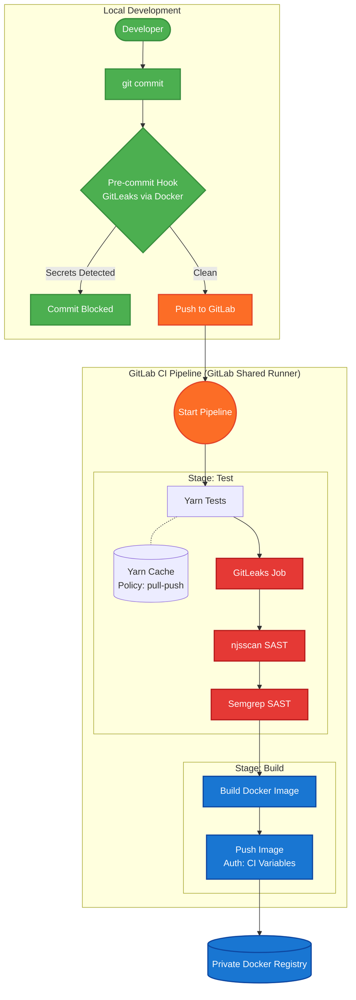
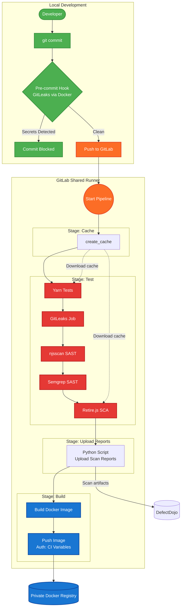
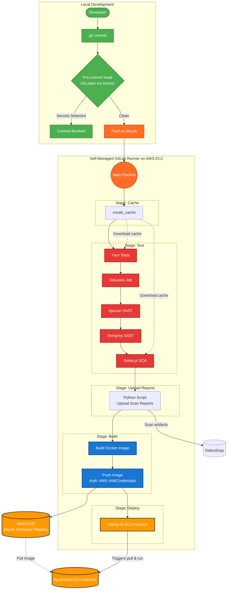
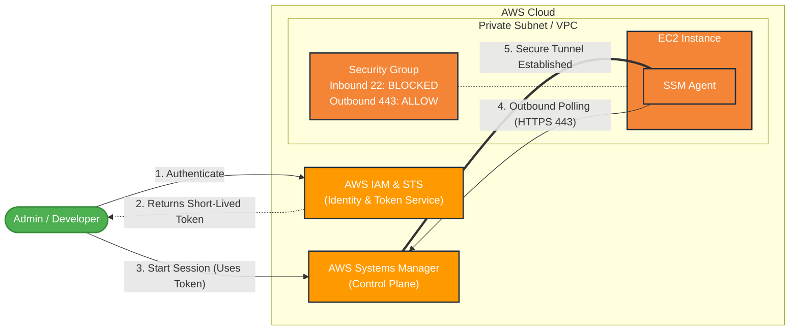
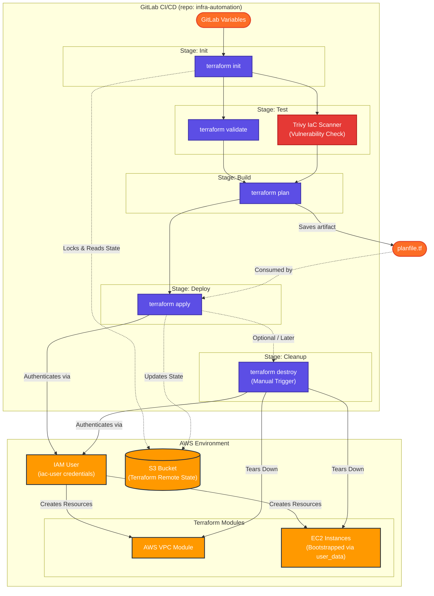
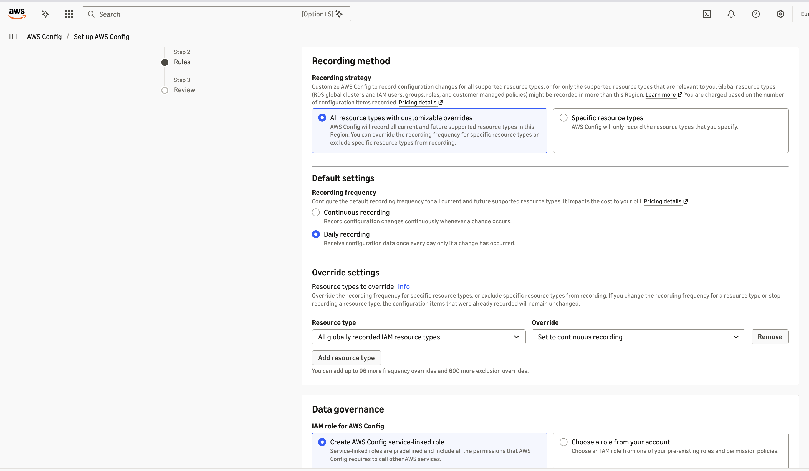
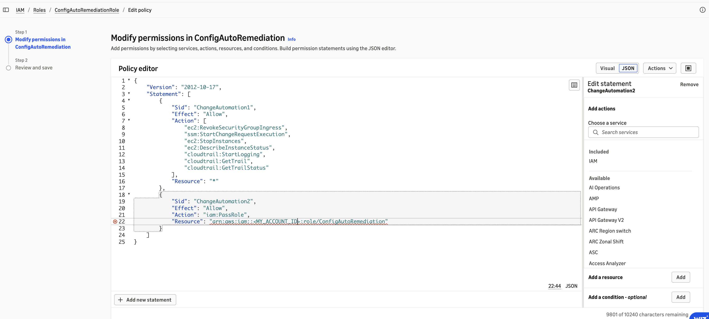

- [Module 3: Application Vulnerability Scanning](#module-3-application-vulnerability-scanning)
  - [Setup GiLab CI pipeline, pre-commit script and SAST scanning](#setup-gilab-ci-pipeline-pre-commit-script-and-sast-scanning)
- [Module 4: Vulnerability Management and Remediation](#module-4-vulnerability-management-and-remediation)
  - [Part 1: GitLab CI scan artifacts and Defect Dojo setup](#part-1-gitlab-ci-scan-artifacts-and-defect-dojo-setup)
  - [Part 2: Automate scan uploads to Defect Dojo](#part-2-automate-scan-uploads-to-defect-dojo)
- [Module 5: Vulnerability Scanning for Application Dependencies](#module-5-vulnerability-scanning-for-application-dependencies)
  - [Software Composition Analysis (SCA)](#software-composition-analysis-sca)
- [Module 6: Build a CD Pipeline](#module-6-build-a-cd-pipeline)
  - [Setup AWS ECR \& EC2 server](#setup-aws-ecr--ec2-server)
  - [Deploy image to EC2](#deploy-image-to-ec2)
  - [Self-managed GitLab Runner](#self-managed-gitlab-runner)
- [Module 7: Image Scanning - Built Secure Docker Images](#module-7-image-scanning---built-secure-docker-images)
  - [Image Scanning](#image-scanning)
- [Module 8: AWS Cloud Security \& Access Management](#module-8-aws-cloud-security--access-management)
- [Module 9: Secure Continuous Deployment \& DAST](#module-9-secure-continuous-deployment--dast)
  - [Configured AWS SSM](#configured-aws-ssm)
  - [Created IAM Roles \& Short-Lived credentials](#created-iam-roles--short-lived-credentials)
  - [Dynamic Application Security Testing (DAST)](#dynamic-application-security-testing-dast)
- [Module 10: IaC and GitOps for DevSecOps](#module-10-iac-and-gitops-for-devsecops)
  - [Create AWS resources via IaC (terraform)](#create-aws-resources-via-iac-terraform)
  - [Create a IaC pipeline](#create-a-iac-pipeline)
- [Module 11: Logging and Monitoring for Security](#module-11-logging-and-monitoring-for-security)
- [Module 12: Kubernetes Security](#module-12-kubernetes-security)
  - [Kubernetes Security Best Practices](#kubernetes-security-best-practices)
  - [EKS Setup](#eks-setup)
- [Module 13: Kubernetes Access Management with AWS EKS](#module-13-kubernetes-access-management-with-aws-eks)
  - [Role Based Access Control (RBAC)](#role-based-access-control-rbac)
- [Module 14: Secure IaC pipeline for EKS provisioning](#module-14-secure-iac-pipeline-for-eks-provisioning)
- [Module 15: Bootstrapping clusters with EKS blueprints](#module-15-bootstrapping-clusters-with-eks-blueprints)
- [Module 16: Application Release pipeline with ArgoCD](#module-16-application-release-pipeline-with-argocd)
- [Module 17: Policy as Code with Open Policy Agent](#module-17-policy-as-code-with-open-policy-agent)
- [Module 18: Secrets Management in Kubernetes](#module-18-secrets-management-in-kubernetes)
- [Module 19: Service Mesh with Istio](#module-19-service-mesh-with-istio)
  - [Part1: Deployed Istio Service Mesh components in EKS Cluster via our Terraform pipeline](#part1-deployed-istio-service-mesh-components-in-eks-cluster-via-our-terraform-pipeline)
  - [Part2: Expose microservice app through Istio gateway via secure HTTPS access](#part2-expose-microservice-app-through-istio-gateway-via-secure-https-access)
  - [Part3: Validated Istio mTLS traffic and configured PeerAuthentication](#part3-validated-istio-mtls-traffic-and-configured-peerauthentication)
  - [Part4: Define Authorization Policies on workloads](#part4-define-authorization-policies-on-workloads)
- [Module 20: Compliance as Code](#module-20-compliance-as-code)
  - [Our AWS Config rules:](#our-aws-config-rules)

---

# Module 3: Application Vulnerability Scanning

## Setup GiLab CI pipeline, pre-commit script and SAST scanning

[Knowledge base](https://gitlab.com/dominikjaro_devsecops_bootcamp/notes_overview/-/blob/main/chapters_notes/03_application_vulnerability_scanning.md?ref_type=heads)

[repo: app_juice_shop](https://gitlab.com/dominikjaro_devsecops_bootcamp/app-juice-shop)

- We use the OWASP open-source app Juice Shop
- Created a basic GitLab CI pipeline for the app which runs on a GitLab shared runner
  - We run Yarn tests, build the image and push to our private docker registry
  (authentication to registry via GitLab CI variables)
  - To make the pipeline faster we configure caching for Yarn dependencies
    - We set the poicy to pull-push for caching -- so it updates when needed
  - `GitLeak` is the next job in the pipeline which scans for secrets in the repo
    - We set `allow_failure` to true for now so it doesn't block the pipeline
    - Save the output `gitleaks.json` as an artifact (will use it latet yo upload it to Defect Dojo) for review
    - To prevent commiting credentials to the repo we set up a Pre-commit hook
      - In the `.git/hook` dir we create a `pre-commit` file with the script to run `gitleaks` (we are using a docker image and passing the app code)
  - `njsscan`is added and configured in the pipeline to SAST checks
    - We add the flag `--exit-warning` to fail on warnings
  - `semgrep` is added and configured in the pipeline for additional SAST checks
    - Again the output is saved as an artifact for review.



---

# Module 4: Vulnerability Management and Remediation

[Knowledge base](https://gitlab.com/dominikjaro_devsecops_bootcamp/notes_overview/-/blob/main/chapters_notes/04_vulnerability_management_and_remediation.md?ref_type=heads)

[repo: app_juice_shop](https://gitlab.com/dominikjaro_devsecops_bootcamp/app-juice-shop)

## Part 1: GitLab CI scan artifacts and Defect Dojo setup

- In the GitLab CI output scan files and store them as artifacts
- Setup DefectDojo producttype > product ...etc for scan tracking

## Part 2: Automate scan uploads to Defect Dojo

- We created a python script `upload-reports.py` to send scan files to Defect Dojo.
- The script is called in the pipeline after the scans and before the build stage.
- Went through the findings and fixed some security issues.

---

# Module 5: Vulnerability Scanning for Application Dependencies

[Knowledge base](https://gitlab.com/dominikjaro_devsecops_bootcamp/notes_overview/-/blob/main/chapters_notes/05_Vulnerability_scanning_for_application_dependencies.md?ref_type=heads)

[repo: app_juice_shop](https://gitlab.com/dominikjaro_devsecops_bootcamp/app-juice-shop)

**DefectDojo**

## Software Composition Analysis (SCA)

- We added another job and tool into the test stage for dependency scanning.
- Retire.js for JS dependencies.
- Now we built a pipeline for static application testing



---

# Module 6: Build a CD Pipeline

[Knowledge_base](https://gitlab.com/dominikjaro_devsecops_bootcamp/notes_overview/-/blob/main/chapters_notes/06_build_a_cd_pipeline.md?ref_type=heads)

[repo: app_juice_shop](https://gitlab.com/dominikjaro_devsecops_bootcamp/app-juice-shop)

**AWS**

## Setup AWS ECR & EC2 server

- Created repository and configured access
- In the build stage now we are building the image and pushing it to ECR (instead of DockerHub)
- Setup EC2 server for deployment
  - To configure the EC2 server we need to install docker, awscli and add ubuntu user to docker group
    - `sudo apt install docker.io -y`
    - `sudo usermod -aG docker ubuntu`
    - `sudo apt install awscli -y`

## Deploy image to EC2

- Stage: `deploy` -- added another stage which pulls the image from ECR and runs it on EC2
  - Using `ssh` to connect and run commands on EC2

## Self-managed GitLab Runner

- Created an EC2 instance for the runner
  - Need: Docker,awscli and GitLab runner installed
  - In `GitLab` created a project runner and registered it with the EC2 instance (add tags to reference the runner)
  - The self-managed runner saves as time as it has the docker images cached (although be aware of disk space, make sure to clean up)


  
---

# Module 7: Image Scanning - Built Secure Docker Images

[Knowledge base](https://gitlab.com/dominikjaro_devsecops_bootcamp/notes_overview/-/blob/main/chapters_notes/07_image_scanning_build_secure_docker_images.md?ref_type=heads)

[repo: app_juice_shop](https://gitlab.com/dominikjaro_devsecops_bootcamp/app-juice-shop)

**AWS**

## Image Scanning

- Added another job in the build stage: Using `trivy` to scan Docker images
  - We are accessing the image in the ECR and pulling it for scanning with `trivy`
  - Output the findings and upload the artifacts to DefectDojo (set severity level HIGH,CRITICAL)
  - Fixed some vulnerabilities, updated version dependencies/subdependencies
  - Learned Docker Security Best Practices
  - Configured automated image security scanning in AWS ECR (most of the cloud platform support it)

---

# Module 8: AWS Cloud Security & Access Management

[AWS Cloud Security & Access Management](https://gitlab.com/dominikjaro_devsecops_bootcamp/notes_overview/-/blob/main/chapters_notes/08_aws_cloud_security_and_access_management.md?ref_type=heads)

---

# Module 9: Secure Continuous Deployment & DAST

[Knowledge base](https://gitlab.com/dominikjaro_devsecops_bootcamp/notes_overview/-/blob/main/chapters_notes/09_secure_continuous_deployment_and_dast.md?ref_type=heads)

[repo: app_juice_shop](https://gitlab.com/dominikjaro_devsecops_bootcamp/app-juice-shop)

**AWS**

## Configured AWS SSM 

- For best practices we set up `SSM` system manager
  - Managed access to EC2 instances securely, instead of using direct SSH (we block port 22)
  - [`aws ssm`](https://docs.aws.amazon.com/cli/latest/reference/ssm/) includes several key features/tools
  - Installed SSM agent on EC2 instances
  - Created an IAM role which will be assumed by the EC2 instances for SSM access

## Created IAM Roles & Short-Lived credentials

- Created an IAM role and assigned it to the GitLab runner instance and App server EC2 instance (Allows EC2 instances to call AWS services)
  - e.g. Permissions to access ECR
  - Removed the env vars/credentials
  (everytime the `aws ssm...` command is used a short-lived credential is generated)

## Dynamic Application Security Testing (DAST)

- Identifying vulnarabilities in a running application
- We are using a tool from OWASP for DAST called ZAP
- Usually DAST testing happens in dev or staging environments before production deployment
- We changed the pipeline a bit -- added `deploy-test` and `deploy-prod` stages
  - Once the application has been deployed to the test environment, DAST scans are run
  - Reports are generated for review
  - We remediated some vulnerabilities found by ZAP
  (it is better to run the basline scanning in the release pipeline and full scan in a separate pipeline as it is slower)



---

# Module 10: IaC and GitOps for DevSecOps

[Knowledge base](https://gitlab.com/dominikjaro_devsecops_bootcamp/notes_overview/-/blob/main/chapters_notes/10_iac_and_gitops_for_devsecops.md?ref_type=heads)

[repo: infra-automation](https://gitlab.com/dominikjaro_devsecops_bootcamp/infra-automation)

**AWS**

## Create AWS resources via IaC (terraform)

- We created a `iac-user` which will be used by the pipeline to create the resources.
  - We had to assign the right IAM permissions.
- We create all the AWS resources via Terraform code.
- For the EC2 instances we are passing the `user_data` script to configure them on launch.
- When in GitLab you set the variable TF_VAR_ for Terraform inputs, e.g., TF_VAR_region -- the pipeline will pick it up automatically.
- In our IaC we are leveraging modules for reusable components like VPC and EC2.

## Create a IaC pipeline 

- In `.gitlab-ci.yml` we set the terarform image for all the steps
- We have stages:
  - `init` to initialize Terraform
  - `test` which validates the configuration -- PLUS we have trivy scans which check for vulnerabilities
  - `build` runs `terraform plan -out planfile.tf` and we save it as artifact
  - `deploy` applies the plan to create resources
  - We have the `destroy` stage as well which can be run manually and can destroy our resources
- We configured remote backend for Terraform state storage - leveraging a S3 bucket.



---

# Module 11: Logging and Monitoring for Security

**AWS**

[Logging and Monitoring for Security](https://gitlab.com/dominikjaro_devsecops_bootcamp/notes_overview/-/blob/main/chapters_notes/11_logging_and_monitoring_for_security.md?ref_type=heads)

---

# Module 12: Kubernetes Security

[repo: devsecops-infra-automation-eks](https://gitlab.com/dominikjaro_devsecops_bootcamp/devsecops-infra-automation-eks)

**AWS**

## Kubernetes Security Best Practices 

[Intro to Kubernetes security](https://gitlab.com/dominikjaro_devsecops_bootcamp/notes_overview/-/blob/main/chapters_notes/12_introduction_to_kubernetes_security.md?ref_type=heads)

## EKS Setup

- Provisioned EKS cluster via Terraform
- We just used an AWS admin user for this setip setup
  - `aws sts get-caller-identity` to check current user

---

# Module 13: Kubernetes Access Management with AWS EKS

[Knowledge Base](https://gitlab.com/dominikjaro_devsecops_bootcamp/notes_overview/-/blob/main/chapters_notes/13_kubernetes_access_management_with_aws_eks.md?ref_type=heads)

[repo: devsecops-infra-automation-eks](https://gitlab.com/dominikjaro_devsecops_bootcamp/devsecops-infra-automation-eks)

**AWS**

## Role Based Access Control (RBAC)

- We are adding Kubernetes provider and additional K8s and AWS resources. e.g.
- RBAC roles and bindings
- Mapping AWS roles to K8s
- IAM roles
- The users are created manually in AWS e.g. k8s-admin, k8s--developers

```mermaid
flowchart LR
    subgraph AWS IAM Layer
        AdminUser(["IAM User<br>(var.user_for_admin_role)"]) -->|sts:AssumeRole| AdminRole["IAM Role:<br>external-admin"]
        DevUser(["IAM User<br>(var.user_for_dev_role)"]) -->|sts:AssumeRole| DevRole["IAM Role:<br>external-developer"]
    end

    subgraph Amazon EKS Cluster
        subgraph Kubernetes Identity
            AdminRole -. "AWS Auth Mapping" .-> K8sGroup(["K8s Group:<br>restricted-admins"])
            DevRole -. "AWS Auth Mapping" .-> K8sUser(["K8s User:<br>developer"])
        end

        subgraph Kubernetes RBAC Bindings
            K8sGroup -->|"ClusterRoleBinding:<br>restricted-admin-binding"| CR["ClusterRole:<br>restricted-admin"]
            K8sUser -->|"RoleBinding:<br>namespace-viewer"| R["Role:<br>namespace-viewer"]
        end

        subgraph Allowed Access Scope
            CR --> ClusterWide[("All Core Resources<br>Cluster-Wide")]
            R --> NS[("Namespace:<br>online-boutique")]
        end
    end

    %% Styling
    classDef aws fill:#FF9900,stroke:#232F3E,stroke-width:2px,color:white;
    classDef k8sIdentity fill:#F53B75,stroke:#A11C47,stroke-width:2px,color:white;
    classDef k8sRbac fill:#326CE5,stroke:#1F438F,stroke-width:2px,color:white;
    classDef k8sScope fill:#4CAF50,stroke:#388E3C,stroke-width:2px,color:white;

    class AdminUser,DevUser,AdminRole,DevRole aws;
    class K8sGroup,K8sUser k8sIdentity;
    class CR,R k8sRbac;
    class ClusterWide,NS k8sScope;
````

---

# Module 14: Secure IaC pipeline for EKS provisioning

[Knowledge Base](https://gitlab.com/dominikjaro_devsecops_bootcamp/notes_overview/-/blob/main/chapters_notes/14_secure_iac_pipeline_for_eks_provisioning.md?ref_type=heads)

[repo: devsecops-infra-automation-eks](https://gitlab.com/dominikjaro_devsecops_bootcamp/devsecops-infra-automation-eks)

**AWS**

- Adding the pipeline for IaC deployment and automation.
- We initialize terraform and build-plan and apply. There is a cleanup step that can be run manually.
- The terraform plan file is saved as an artifact, so it can be applied later.
- We are using a terraform image, however had to install aws cli on it for authentication.
- In AWS under Access Management I created an Identity Provider for GitLab OIDC, then a Web Identity role, which has the Trust relationship with the Identity Provider, allowing GitLab to assume the role and interact with AWS resources securely.

---

# Module 15: Bootstrapping clusters with EKS blueprints

[Knowledge Base](https://gitlab.com/dominikjaro_devsecops_bootcamp/notes_overview/-/blob/main/chapters_notes/15_bootstrapping_clusters_with_eks_blueprints.md?ref_type=heads)

[repo: devsecops-infra-automation-eks](https://gitlab.com/dominikjaro_devsecops_bootcamp/devsecops-infra-automation-eks)

**AWS**

- Added Helm provider and add_ons for e.g. `aws_load_balancer_controller`, `metrics-server`, `cluster_autoscaler`
- Added some additional autoscaler settings


# Module 16: Application Release pipeline with ArgoCD

[Knowledge Base](https://gitlab.com/dominikjaro_devsecops_bootcamp/notes_overview/-/blob/main/chapters_notes/16_application_release_pipeline_with_argocd.md?ref_type=heads)

[repo: devsecops-infra-automation-eks](https://gitlab.com/dominikjaro_devsecops_bootcamp/devsecops-infra-automation-eks)

[repo: online-boutique-gitops](https://gitlab.com/dominikjaro_devsecops_bootcamp/online-boutique-gitops)

**AWS**

- Adding ArgoCD for GitOps management using helm charts.
- Adding ArgoCD secret for authentication in the cluster -- if I port-forward to the argocd-server pod I can use the secret to access the UI.
- I configure `gitops_url`, `gitops_username`, `gitops_password` for ArgoCD access -- the variables come from GitLab.
- In the `online-boutique-argo-app.yaml` I set the source repoURL, path and other policies.
- We are using the Online Boutique demo app from [microservice demos GitHub](https://github.com/googlecloudplatform/microservices-demo).
- The app will sync automatically with the repo.
- Adding another `deploy_argocd` step in the CD pipeline for updates (I use an image with awscli and kubectl on it).

```mermaid
flowchart TD
    User(["Developer / Admin"])

    subgraph GitLab ["GitLab Ecosystem"]
        CIVars(["GitLab CI Variables<br>(gitops_url, username, password)"])
        CIPipe["CD Pipeline<br>Job: deploy_argocd"]
        GitOpsRepo[("GitOps Repository<br>online-boutique-gitops")]
    end

    subgraph Amazon EKS Cluster
        subgraph argocd ["Namespace: argocd"]
            Helm["Helm Release: argo-cd<br>(v6.4.0)"]
            ArgoController["ArgoCD Server & Controller"]
            RepoSecret["K8s Secret: gitops-k8s-repo<br>"]
            AppCR["ArgoCD Application<br>(online-boutique)"]

            Helm -. "Provisions" .-> ArgoController
        end

        subgraph default_ns ["Namespace: online-boutique"]
            Boutique["Google Online Boutique<br>(Microservice Demo App)"]
        end
    end

    %% Provisioning & Setup
    CIVars -. "Injected by Terraform" .-> RepoSecret
    CIPipe -- "kubectl apply<br>online-boutique-argo-app.yaml" --> AppCR
    
    %% User Access
    User -- "kubectl port-forward<br>(Login via initial admin secret)" --> ArgoController

    %% GitOps Continuous Delivery Flow
    AppCR -. "Defines Source & Destination" .-> ArgoController
    ArgoController -- "1. Authenticates using" --> RepoSecret
    ArgoController -- "2. Watches & Pulls<br>(path: overlays/dev)" --> GitOpsRepo
    ArgoController == "3. Automated Sync " === Boutique

    %% Styling
    classDef gitlab fill:#FC6D26,stroke:#E24329,stroke-width:2px,color:white;
    classDef argocd fill:#EF7B4D,stroke:#C6582D,stroke-width:2px,color:white;
    classDef k8s fill:#326CE5,stroke:#1F438F,stroke-width:2px,color:white;
    classDef user fill:#4CAF50,stroke:#388E3C,stroke-width:2px,color:white;

    class User user;
    class CIVars,CIPipe,GitOpsRepo gitlab;
    class Helm,ArgoController,RepoSecret,AppCR argocd;
    class Boutique k8s;
```

# Module 17: Policy as Code with Open Policy Agent

[Knowledge Base](https://gitlab.com/dominikjaro_devsecops_bootcamp/notes_overview/-/blob/main/chapters_notes/17_policy_as_code_with_open_policy_agent.md?ref_type=heads)

[repo: devsecops-infra-automation-eks](https://gitlab.com/dominikjaro_devsecops_bootcamp/devsecops-infra-automation-eks)

[repo: online-boutique-gitops](https://gitlab.com/dominikjaro_devsecops_bootcamp/online-boutique-gitops)

- Adding the gatekeeper helm chart for policy enforcement. (in the repo: online-boutique-gitops you can find the contrainttemplate and the constraint) for enforcing policies.
- To see the CRDs, I had to add another RBAC role:

```hcl
rule {
    api_groups = ["apiextensions.k8s.io"]
    resources  = ["customresourcedefinitions"]
    verbs      = ["get", "list", "describe"]
  }
```

- In the file platform-argo-app.yaml I define the path to the gitops repo.

- Platform & Policy Enforcement: Open Policy Agent (OPA) Gatekeeper policies enforcing security baselines across the cluster.
- Cluster security policies are declared under platform/ using OPA Gatekeeper ConstraintTemplates and Constraints:
  - Disallow Privileged Containers: Blocks any container attempting to run with securityContext.privileged: true to prevent container breakout risks.
  - Block NodePort Services: Prevents services from using NodePort to avoid exposing them outside the cluster.


# Module 18: Secrets Management in Kubernetes

[Knowledge Base](https://gitlab.com/dominikjaro_devsecops_bootcamp/notes_overview/-/blob/main/chapters_notes/18_secrets_management_in_kubernetes.md?ref_type=heads)

[repo: devsecops-infra-automation-eks](https://gitlab.com/dominikjaro_devsecops_bootcamp/devsecops-infra-automation-eks)

[repo: online-boutique-gitops](https://gitlab.com/dominikjaro_devsecops_bootcamp/online-boutique-gitops)

**AWS**

- Manually created a secret in AWS Secrets Manager for the cluster.
- In Terraform we created a AWS IAM Role with permissions that will be Assumed to READ the secret.
- Created a K8s Service Account which is mapped to the IAM Role for secret access.
- Added external_secrets in EKS Blueprints addons.

---

# Module 19: Service Mesh with Istio

## Part1: Deployed Istio Service Mesh components in EKS Cluster via our Terraform pipeline

**repo: Infra**

- I installed `istiod`, `istio-base` and `istio-ingress-gateway` components in the cluster.
- I added cluster and node level security groups and rules for secure communication.
- By adding a label I enable Istio envoy proxy injection (at first for one namespace only).
  - It means only the objects in that namespace will get the proxy injected.
- The IaC pipeline will create the necessary resources.

## Part2: Expose microservice app through Istio gateway via secure HTTPS access

**repo: GitOps**

- Configured traffic routing in cluster via Istio gateway.
  - At first we test with HTTP(80) before enabling HTTPS.
  - Generated a self-signed certificate useing `openssl` for TLS communication and store it in AWS Secret Manager.
  `openssl req -x509 -sha256 -nodes -days 365 -newkey rsa:4096 -subj '/CN=onlineboutique.dom.com' -keyout key.pem -out cert.pem`
  - We enabled HTTPS(443) and redirect all HTTP traffic to it.
  - For the TLS certificate and key we use AWS Secret Manager and K8s external secrets.
- Created a Virtual Service for the frontend application to route traffic through the gateway to the service.

## Part3: Validated Istio mTLS traffic and configured PeerAuthentication

**repo: GitOps**

- Downloaded tool `istioctl`
- Configured PeerAuthentication
  - Set mode to STRICT for mTLS in the namespace `online-boutique`
  (That means pods can't communicate in Plaintext)

## Part4: Define Authorization Policies on workloads

**repo: GitOps**

- Created an `AuthorizationPolicy` (`frontend-policy`) targeting `app: frontend` in the `online-boutique` namespace.
  - Configured a `DENY` rule blocking requests from other pods inside `online-boutique` on port `80, 8080` while permitting external traffic routed from `istio-ingress`.
- Created a namespace-level policy deployed in `online-boutique` to DENY all incoming traffic originating from the `argocd` namespace.
- To test the communication we also used a test pod in the cluster:
  - `kubectl run -it --image curlimages/curl -n online-boutique --restart=Never mypod -- sh`

```mermaid
flowchart TD
    User([User Request HTTPS 443]) --> NLB

    subgraph AWS VPC
        NLB[AWS Network Load Balancer\nIngress: 80/443\nEgress: All]
        
        subgraph EKS Cluster Nodes
            NLB -- "NodePort (30000-32767)" --> IGW
            
            subgraph istio-system [namespace: istio-system]
                Istiod[Istiod Control Plane\nWebhook Port: 15017]
                IGW[Istio Ingress Gateway\nEnvoy Proxy]
            end
            
            subgraph online-boutique [namespace: online-boutique]
                VS[VirtualService\nRouting Rules]
                
                subgraph Pods
                    FE[Frontend Pod]
                    Sidecar[Envoy Sidecar]
                    FE -.- Sidecar
                end
            end
            
            subgraph argocd [namespace: argocd]
                Argo[ArgoCD Pods]
                ArgoSidecar[Envoy Sidecar]
                Argo -.- ArgoSidecar
            end
        end
    end

    IGW -- "VirtualService routes traffic" --> VS
    VS -- "STRICT mTLS (PeerAuthentication)" --> Sidecar
    Istiod -. "Injects Sidecars & Certs" .-> Sidecar
    Istiod -. "Injects Sidecars & Certs" .-> ArgoSidecar
    Istiod -. "Injects Sidecars & Certs" .-> IGW
    
    ArgoSidecar -- "Blocked by AuthorizationPolicy" --x Sidecar

    classDef aws fill:#FF9900,stroke:#232F3E,stroke-width:2px,color:white;
    classDef istio fill:#466BB0,stroke:#2b426d,stroke-width:2px,color:white;
    classDef k8s fill:#326ce5,stroke:#1f438f,stroke-width:2px,color:white;
    
    class NLB aws;
    class Istiod,IGW,Sidecar,ArgoSidecar istio;
    class VS,FE,Argo k8s;
  ```

---

# Module 20: Compliance as Code

[Knowledge_Base](https://gitlab.com/dominikjaro_devsecops_bootcamp/notes_overview/-/blob/main/chapters_notes/20_compliance_as_code.md?ref_type=heads)

**AWS**

## Our AWS Config rules:

- We are restricting `ssh`access to our servers - with this rule we are monitoring unauthorized access attempts.
- Ensure CloudTrail is enabled.
- `eks-clusteroldest-supported-version`
- `eks-cluster-logging-enabled` -- we need this for the above role as AWS Config checks the EKS clusters via cluster logging

In my config I created the config for daily checks(jus because price is lower).



Remediation can be automated with `aws ssm` config rules.

We created 2 automated remediation for our AWS configs.

1. restricted ssh access
2. CloudTrail enabled

- AWS Config detects non-compliant resources then --> it delegates remediation to SSM (runbook).
(for this We created an IAM role e.g. with permissions to change security group rules --  this IAM role is assumed by SSM)

We created a custom policy called ConfigAutoRemediation with the necessary permissions for SSM to remediate our resources **restricted ssh access** and **CloudTrail**.



---

```mermaid
flowchart TD
    PublicUser([End User / Client])

    subgraph DevPhase ["1. Local Development (Shift-Left)"]
        Dev([Developer]) -->|Pre-commit Hook<br>GitLeaks| GitPush[Push Code]
    end

    subgraph GitLab ["2. GitLab Version Control & CI/CD"]
        GitPush --> AppRepo[Application Repo]
        GitPush --> GitOpsRepo[GitOps Repo<br>K8s Manifests]
        
        subgraph Pipeline ["Continuous Integration Pipeline"]
            SecScans["Security Scans<br>(njsscan, Semgrep, Retire.js, Trivy)"]
            BuildPush["Build Image & Push"]
            AppRepo --> SecScans --> BuildPush
        end
    end

    subgraph SecOps ["3. Vulnerability Management"]
        DefectDojo[("DefectDojo<br>(Vulnerability Dashboard)")]
        SecScans -. "Uploads Artifacts" .-> DefectDojo
    end

    subgraph AWS ["4. AWS Cloud Infrastructure"]
        ECR[("AWS ECR<br>(Container Registry)")]
        SecretsManager[("AWS Secrets Manager")]
        
        BuildPush -- "Authenticates & Pushes Image" --> ECR
        
        subgraph EKS ["5. Amazon EKS Cluster"]
            
            subgraph ArgoCD ["Namespace: argocd"]
                Argo["ArgoCD Controller<br>(GitOps)"]
            end

            subgraph SecurityOps ["Cluster Operations & Policy"]
                OPA["OPA Gatekeeper<br>(Policy as Code)"]
                ES["External Secrets Operator"]
            end

            subgraph Mesh ["Namespace: istio-system"]
                IGW["Istio Ingress Gateway"]
                Istiod["Istiod Control Plane"]
            end

            subgraph Workload ["Namespace: online-boutique"]
                AppPod["Frontend Application"]
                Sidecar["Envoy Proxy Sidecar"]
                AppPod -.- Sidecar
            end
        end
    end

    %% GitOps & Provisioning Flow
    GitOpsRepo -. "1. Monitored by" .-> Argo
    Argo -. "2. Pulls Image" .-> ECR
    Argo == "3. Automated Sync" === Workload
    
    %% Security & Secrets Flow
    ES -. "Fetches credentials" .-> SecretsManager
    ES -- "Injects TLS certs" --> Mesh
    OPA -. "Enforces security context" .-> Workload

    %% Traffic Flow
    PublicUser -- "HTTPS (Port 443)" --> IGW
    IGW -- "VirtualService<br>STRICT mTLS" --> Sidecar

    %% Styling
    classDef gitlab fill:#FC6D26,stroke:#E24329,stroke-width:2px,color:white;
    classDef aws fill:#FF9900,stroke:#232F3E,stroke-width:2px,color:white;
    classDef sec fill:#E53935,stroke:#B71C1C,stroke-width:2px,color:white;
    classDef k8s fill:#326CE5,stroke:#1F438F,stroke-width:2px,color:white;
    classDef mesh fill:#466BB0,stroke:#2b426d,stroke-width:2px,color:white;
    classDef user fill:#4CAF50,stroke:#388E3C,stroke-width:2px,color:white;
    
    class Dev,PublicUser user;
    class AppRepo,GitOpsRepo,Pipeline,BuildPush gitlab;
    class ECR,SecretsManager aws;
    class SecScans,DefectDojo,OPA sec;
    class Argo,ES,AppPod k8s;
    class IGW,Istiod,Sidecar mesh;
```